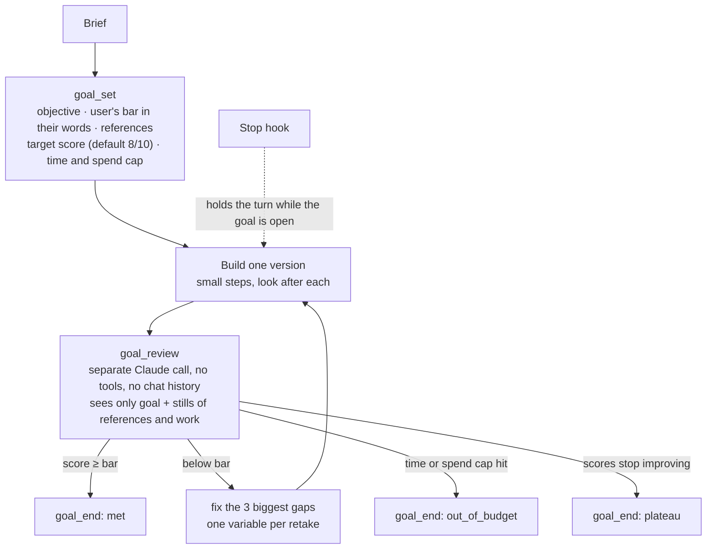

<div align="center">

# Open Harness

**A creative agent for the desktop. One brief in, campaign work out, each version scored by an independent reviewer call before it counts as done.**


<sub>Concept launch film (2× speed). The brand "oto" is fictional and the app window is a recreation for the edit; the timings in the copy are not measurements.</sub>

[Website](https://open-harness-lime.vercel.app/) · [How the quality loop works](#the-quality-loop) · [Quick start](#quick-start) · [Status](#status)

</div>

---

## What it is

Open Harness is a harness around Claude Code for creative work: images, video, 3D, motion, audio and the edit that ties them together. It runs on **your own Claude subscription** on your Mac. There is no hosted service, no account and no per-seat fee.

The model does the thinking. The harness gives it the environment for production work and keeps it honest:

- **Tools for the real apps.** A creative MCP server drives Blender (live window or headless renders), AI image, video and audio providers, ffmpeg, Figma files and a job queue. 68 skills describe how to work in specific tools and formats, from After Effects and DaVinci Resolve to Remotion and Blender.
- **A quality goal the agent cannot skip.** The agent sets a bar, and an independent reviewer call scores every version. The turn is held open until the bar is met, the budget runs out or the scores stop improving.
- **Money as a first-class constraint.** Every paid generation is quoted before it runs and capped by the user's own words. Variants are made as cheap drafts, and only the version you keep is finished at full price.
- **Brand on every turn.** The project's brand kit travels with each message, so the tenth request is as on-brand as the first.
- **Proof at the end.** `/case-study` turns a finished thread into a case-study page, PDF and video, with client names redacted when the work is confidential.

## The quality loop



How it is enforced, not just suggested:

1. **The reviewer never sees the agent's reasoning.** `goal_review` starts a separate Claude call (same model, no tools, no chat history) that gets only the goal, the user's criteria and stills of the references and of the new version. It returns a 0–10 score, whether the bar is met, up to 8 concrete gaps (biggest first) and up to 4 strengths.
2. **The agent cannot declare victory early.** A Claude Code `Stop` hook blocks the end of the turn while the goal is open. `goal_end` with `met` is accepted only after the latest review cleared the bar. Holds are bounded (2 without a review, 24 in total, 12 reviews), so a stuck agent cannot loop forever.
3. **The agent cannot quit early either.** `plateau` and `out_of_budget` are accepted only when the harness says the scores stalled or a limit was reached. `ended` requires a verbatim quote of the user asking to stop.
4. **The user stays in charge.** An interrupt or `/goal clear` releases the hold immediately; if the user asks to stop, the agent closes the goal as `ended` with their words quoted.
5. **The loop shows in the UI.** The thread's goal line shows the latest score against the bar, the top gaps, the number of reviews and the time used.

The working method sits in the `quality-loop` skill: references and a written brief with a rubric first, cheap previews, one contact sheet per check, fixing only the three biggest gaps per round, judging stochastic outputs on at least two samples, and a take ledger, so every version is a new file and nothing is overwritten.

## Spend control

| Mechanism | What it does |
| --- | --- |
| `media_estimate` / `media_quote_plan` | Prices a request or a whole plan per provider route before anything runs. |
| Budget hook | A paid generation is refused unless the spend cap was taken from the user's own words. |
| Drafts → finish | 2–4 cheap drafts for subjective choices, then `media_finish_draft` / `media_upscale` only for the keeper. |
| Provider routing | The same model can run on several providers (fal, Runware, Replicate); the cheapest route that can carry the request is offered. |
| Ledger | Each generation is logged with its cost, so the thread knows what it has spent. |

Worked example, calculated from the providers' published prices rather than measured on an invoice: a 10 s, 1080p Seedance 2.5 shot with 4 versions to choose from costs **$46.56** when every version is rendered at 1080p on fal, and **$10.19** when the harness routes the job to the cheapest provider (Runware), makes 4 drafts and finishes only the chosen one at 1080p. That is 78% less. Drafts alone, staying on fal, would bring it to $20.46; routing does the rest. The fal draft price is our assumption and Runware's finish price is derived from its published token rate (see `packages/creative-mcp/src/media/catalog.ts`).

## Brand and context

- **Brand kit per project** (`brand/`): colours, type, logo, voice. A compact `<oh_brand>` block (max 1500 characters) is added to every turn sent to the model, while the stored message keeps only the user's own words. A brand chip in the composer shows what is active; `brand/ACTIVE` picks a captured brand and `brand/NONE` switches it off.
- **`@` picker** for files, threads, creative apps and connected MCP servers. Apps are inserted as chips, so the agent knows which tool you mean.

## Under the hood

```
apps/server/src/openHerness/      hooks: quality goal (Stop), spend, brand + app context
packages/creative-mcp/            stdio MCP server injected into every Claude session
  src/goal/                       goal_set · goal_review · goal_end
  src/media/                      providers, price catalog, routing, jobs, ledger
  src/blender/                    live bridge + headless render
  src/case/                       /case-study: brief, key moments, PDF, MP4, redaction
  src/figma/                      .fig decoder (local), SVG, REST tools  [experimental]
  plugin/skills/                  68 skills
apps/web/                         UI: composer chips, goal line, generation cards, deliverables
```

After `pnpm install`, the creative MCP server also works with Claude Code in a plain terminal:

```bash
claude mcp add open-harness -- node <repo>/packages/creative-mcp/src/server.ts
```

## Quick start

Requirements: macOS, Node 26.12.1 (exact version), pnpm 12.14, [Claude Code](https://claude.com/product/claude-code) installed and logged in (`claude auth login`). Blender and ffmpeg are optional, but most creative skills use them.

```bash
pnpm install
pnpm dev:desktop
```

Provider keys (fal, OpenAI, Google, ElevenLabs, Runware, Replicate) are asked for inside the app the first time a tool needs one. They are kept on your machine.

## Status

**Pre-release, personal fork, macOS only.** It is used for the author's own production work. Known gaps:

- The code and app name still say "Open Herness" in places; the product name is Open Harness.
- Figma support has not yet been tested on a real `.fig` file.
- A long reviewer call can still leave a turn hanging, and the spend ledger can under-count multi-image jobs. Both are on the fix list.

Tests at the 2026-11-09 integration: typecheck 41/41 packages, creative MCP 139 vitest + 31 node:test passing, server suite 6635 passing with 9 known environment-specific failures.

## Built on T3 Code

Open Harness is a fork of [T3 Code](https://github.com/pingdotgg/t3code) by T3 Tools Inc. (MIT), an excellent agent harness control surface. Threads, checkpoints, diffs, the provider adapters and the desktop shell come from upstream; the creative layer above is this fork's work. The original upstream README is kept in [docs/T3CODE-README.md](docs/T3CODE-README.md). License: [MIT](LICENSE).
